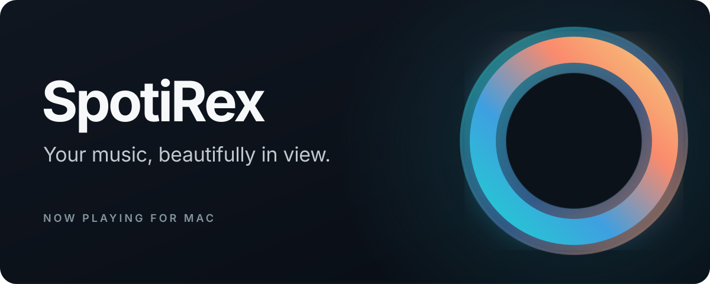
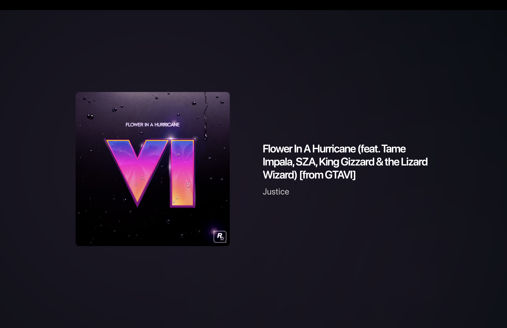
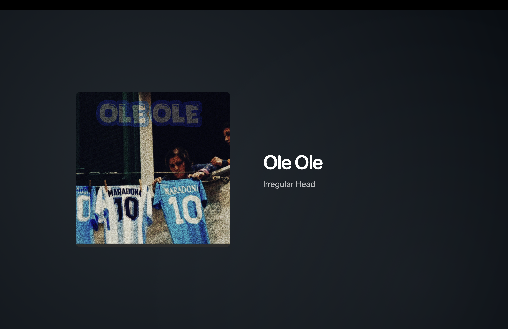
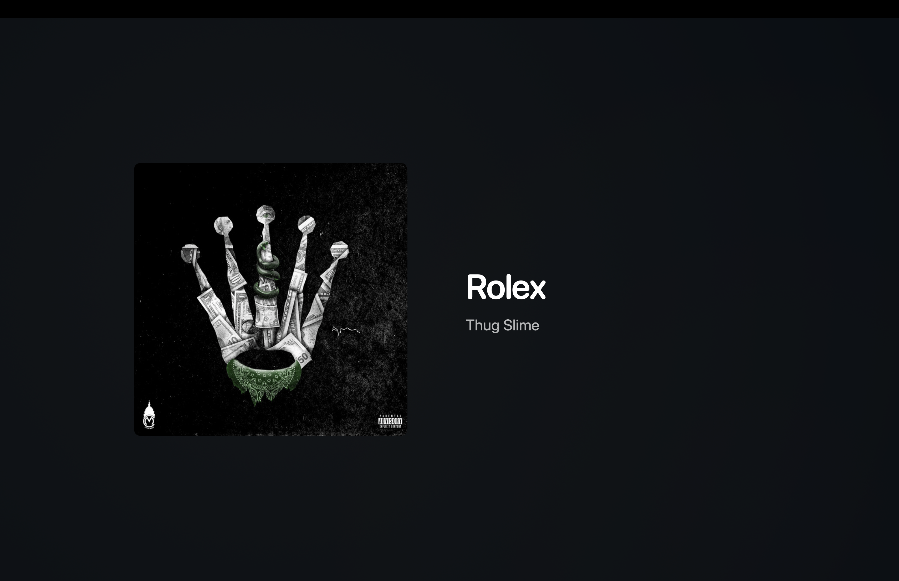
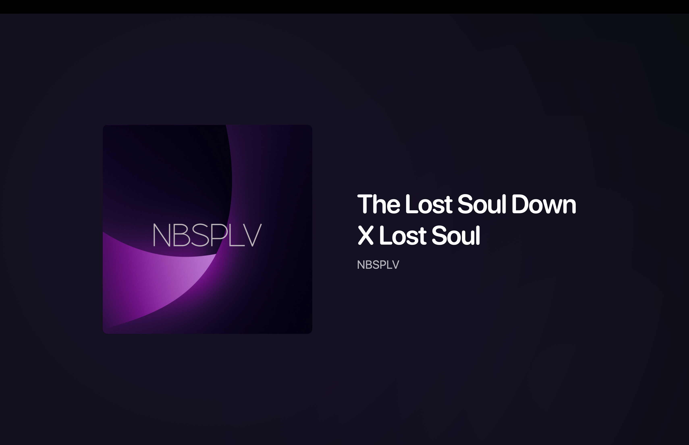

# SpotiRex

**A little more room for the music you love.** SpotiRex turns what's playing on your Mac into a clean, full-window display with album artwork, track details, and colors drawn from the cover.

It works with **Spotify**, **Apple Music**, and **Velora**. Pick a favorite source or let SpotiRex follow the one that's playing. It's a display for your music, with no playback controls to get in the way.

## Take a look

<p align="center">
  
  
  
  
</p>

The details appear when a new track starts or you move your pointer over the window, then settle into a simpler view after ten seconds. You can also keep the minimal view on all the time. While the player window is visible, SpotiRex asks macOS to keep the display awake.

## Get started

SpotiRex needs **macOS 14 or later**. There isn't a downloadable release yet; for now, build it from source using Xcode with Swift 5.10 or later:

```sh
git clone https://github.com/Houloude9IOfficial/SpotiRex.git
cd SpotiRex
./Scripts/build-app.sh
open dist/SpotiRex.app
```

Play something in the Spotify or Apple Music Mac app and allow the macOS **Automation** request when it appears. Spotify playback on another device is not shown. For Velora, enable its **Local API**, then choose **Connect Velora (read only)** in SpotiRex Settings and approve the request in Velora. You can choose a source in Settings or leave it on **Auto**.

SpotiRex reads what's playing; it never sends playback commands. The optional Velora read token is kept in macOS Keychain. The locally built app uses an ad hoc signature and is not a notarized distribution build.

## Help shape it

Ideas, bug reports, and code contributions are welcome. See [Contributing](CONTRIBUTING.md) for the short guide, and [Security](SECURITY.md) for private vulnerability reporting.

SpotiRex is available under the [MIT License](LICENSE). Album artwork and music details shown in the Showcase screenshots belong to their respective rights holders and are **not** covered by the project license. SpotiRex is an independent project and is not affiliated with Spotify or Apple.
